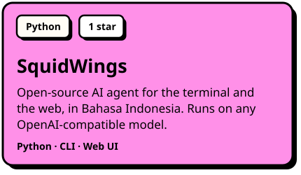
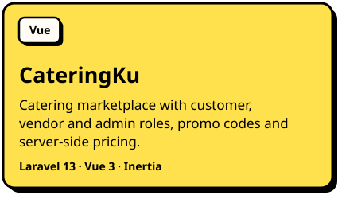
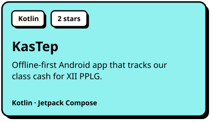
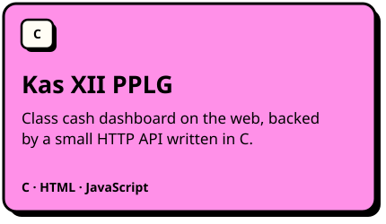
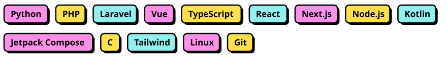
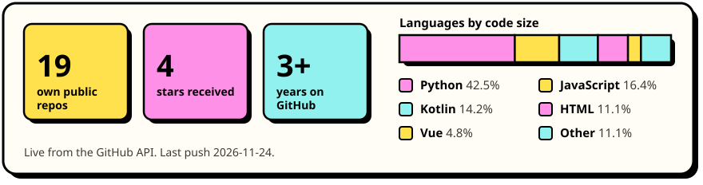

<picture>
  <source media="(prefers-color-scheme: dark)" srcset="assets/banner-dark.svg">
  
</picture>

I'm in class XII PPLG (software engineering) at SMKN 2 Kuta Selatan, Bali. Most of what I build starts from a real need: my class needed a way to track cash, so it got a web dashboard, then three Android apps. Right now most of my time goes into **SquidWings**, an open-source AI agent that speaks Bahasa Indonesia.

### Things I've built

<a href="https://github.com/zynxx24/SquidWings"><picture><source media="(prefers-color-scheme: dark)" srcset="assets/project-squidwings-dark.svg"></picture></a> <a href="https://github.com/zynxx24/CateringKu-ZynxWira-"><picture><source media="(prefers-color-scheme: dark)" srcset="assets/project-cateringku-dark.svg"></picture></a>
<a href="https://github.com/zynxx24/KasTep"><picture><source media="(prefers-color-scheme: dark)" srcset="assets/project-kastep-dark.svg"></picture></a> <a href="https://github.com/zynxx24/Kas-XIIPPLG---cash-management"><picture><source media="(prefers-color-scheme: dark)" srcset="assets/project-kas-xii-pplg-dark.svg"></picture></a>

More: [AppCash](https://github.com/zynxx24/AppCash) and [KasKu](https://github.com/zynxx24/kasku) (two more takes on the class cash app) · [XI PPLG class website](https://zynxx24.github.io/XI-PPLG/general/)

### What I work with

<picture>
  <source media="(prefers-color-scheme: dark)" srcset="assets/stack-dark.svg">
  
</picture>

### On GitHub

<picture>
  <source media="(prefers-color-scheme: dark)" srcset="assets/stats-dark.svg">
  
</picture>

### Right now

- Making SquidWings run well on cheap models: checking tool results, breaking loops, escalating only when needed.
- Hardening my web apps against the usual holes (OWASP Top 10) and writing tests for them.
- Learning more Linux and security on the side.

### Say hi

[zynxx24.github.io](https://zynxx24.github.io/) · [LinkedIn](https://linkedin.com/in/gdeaguswiradarmaputra) · [Instagram](https://instagram.com/gdeguswiradarmaputra)

The cards above are built from live GitHub API data by [`scripts/build_profile.py`](scripts/build_profile.py) and refreshed every day by a GitHub Action.
